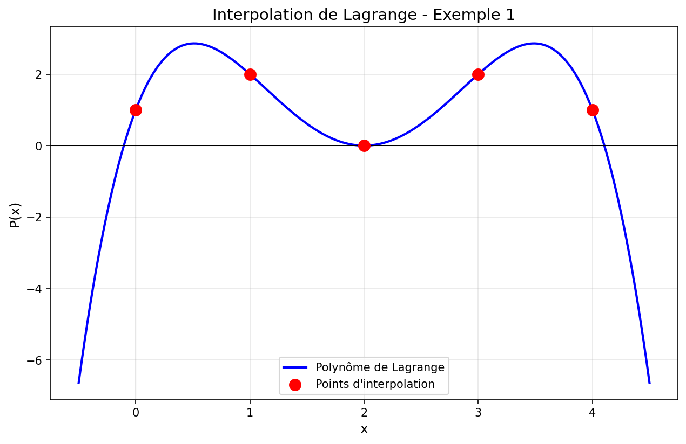
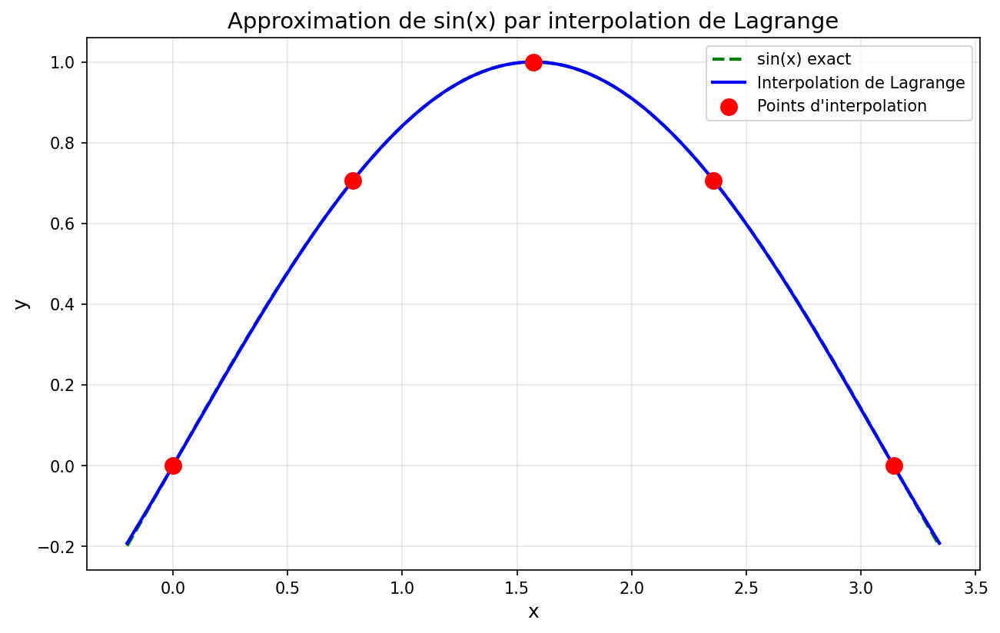
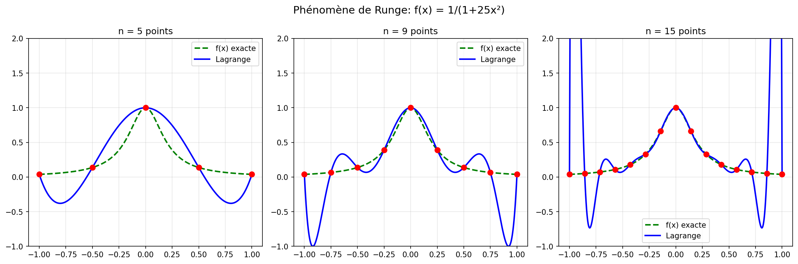

# Moindres carrés & pseudo-inverse de Moore-Penrose

Étude personnelle des moindres carrés linéaires : trois méthodes de résolution (équations normales, QR, SVD), pseudo-inverse de Moore-Penrose, régularisation de Tikhonov, et applications (régression, interpolation polynomiale, phénomène de Runge).

## Contexte

En cours d'algèbre linéaire numérique j'ai croisé les moindres carrés comme une formule (« $\hat{x} = (A^T A)^{-1} A^T b$ »). En pratique, **personne ne calcule comme ça** : la matrice $A^T A$ amplifie les erreurs d'arrondi (son conditionnement est le **carré** de celui de $A$). J'ai voulu reprendre les choses proprement : pourquoi la factorisation QR est numériquement plus stable, ce que la SVD ajoute (cas $A$ non de plein rang), et comment Tikhonov régularise les problèmes mal conditionnés.

## Rappel du cours

### Le problème

Étant donnée une matrice $A \in \mathbb{R}^{m \times n}$ ($m \geq n$) et un vecteur $b \in \mathbb{R}^m$, on cherche $\hat x \in \mathbb{R}^n$ qui minimise :
$$
\hat x = \arg\min_x \lVert Ax - b \rVert_2^2.
$$

### Trois méthodes équivalentes mathématiquement, pas numériquement

| Méthode | Formule | Stabilité | Complexité |
|---|---|---|---|
| Équations normales | $\hat x = (A^T A)^{-1} A^T b$ | ❌ mauvaise (cond² (A)) | $O(mn^2 + n^3)$ |
| Factorisation QR | $A = QR$, $\hat x = R^{-1} Q^T b$ | ✅ bonne | $O(mn^2)$ |
| SVD | $A = U\Sigma V^T$, $\hat x = V\Sigma^+ U^T b$ | ✅ excellente | $O(mn^2 + n^3)$ |

### Pseudo-inverse de Moore-Penrose

Quand $A$ n'est pas de plein rang (colonnes dépendantes, problème sous-déterminé), $A^T A$ n'est pas inversible et les équations normales échouent. La **SVD** donne une solution unique au sens de la norme minimale via la pseudo-inverse :
$$
A^+ = V \Sigma^+ U^T, \quad \text{où } \Sigma^+_{ii} = \begin{cases} 1/\sigma_i & \text{si } \sigma_i > 0 \\ 0 & \text{sinon}\end{cases}.
$$
On a alors $\hat x = A^+ b$, qui est la solution **de norme euclidienne minimale** parmi toutes celles qui minimisent $\lVert Ax - b \rVert_2$.

### Régularisation de Tikhonov

Pour un problème mal conditionné on minimise plutôt :
$$
\lVert Ax - b \rVert_2^2 + \lambda \lVert x \rVert_2^2 \quad \Rightarrow \quad \hat x = (A^T A + \lambda I)^{-1} A^T b.
$$
$\lambda$ contrôle le compromis biais–variance, comme dans la régression ridge en ML.

## Contenu du notebook

| Bloc | Sujet |
|---|---|
| 1 | Rappel théorique (notations, normes, projection orthogonale) |
| 2 | Implémentation des 3 méthodes (`least_squares_normal`, `_qr`, `_svd`) |
| 3 | **Exercice 1** — régression linéaire simple à la main |
| 4 | **Exercice 2** — comparaison numérique des 3 méthodes (100×10) |
| 5 | **Exercice 3** — pseudo-inverse pour matrice non de plein rang |
| 6 | **Exercice 4** — Tikhonov sur un système mal conditionné |
| 7 | Application : interpolation polynomiale (Lagrange) et phénomène de Runge |

Chaque exercice a sa correction dépliable.

📄 Le rapport rédigé est dans `rapport.pdf` (source `rapport.tex`).

## Quelques résultats visuels







Le phénomène de Runge illustre pourquoi on préfère **les splines** ou **la régression polynomiale par moindres carrés** à l'interpolation polynomiale exacte : quand le degré augmente, l'erreur explose aux bords de l'intervalle.

## Comment lancer

```bash
pip install -r requirements.txt
jupyter notebook moindres_carres.ipynb
```

## Contenu du repo

| Fichier | Description |
|---|---|
| `moindres_carres.ipynb` | Notebook complet (théorie + 4 exercices + application) |
| `rapport.pdf` | Rapport rédigé (LaTeX) |
| `rapport.tex` | Source LaTeX |
| `assets/` | Figures (Lagrange, Runge) |
| `requirements.txt` | Dépendances Python |

## Auteur

**Daoud Hechaïchi** — Élève-ingénieur ETI, CPE Lyon
[Portfolio](https://daoud-hechaichi-cv.vercel.app) · [LinkedIn](https://linkedin.com/in/daoud-he)

## License

MIT
